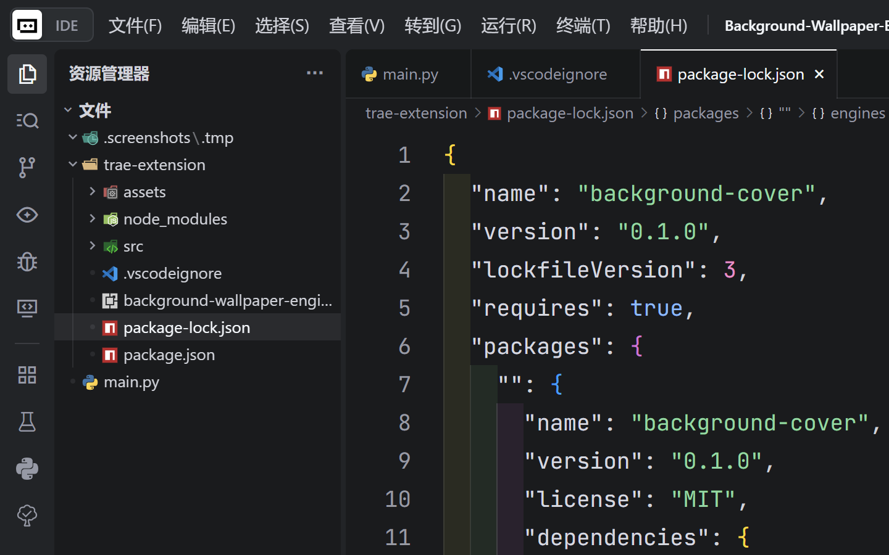
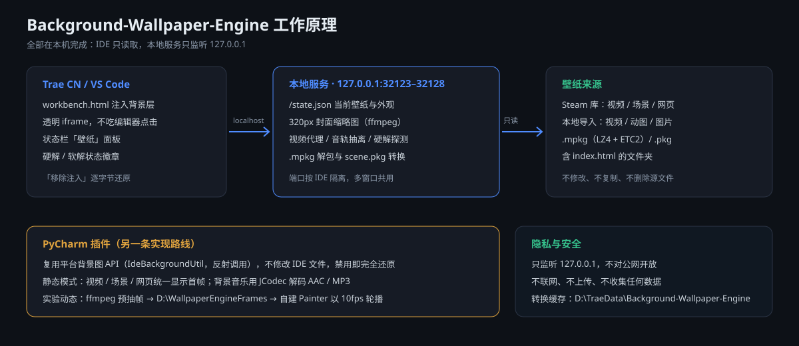
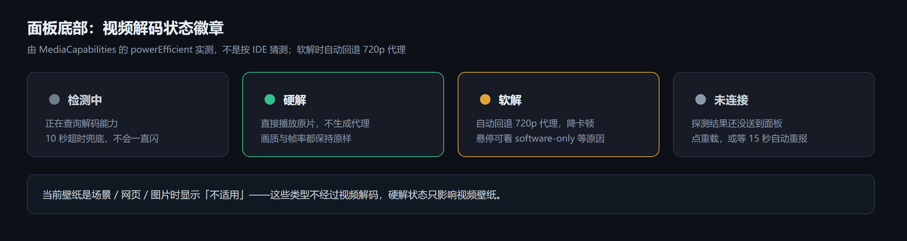

# python-Wallpaper-Engine

把 **Steam Wallpaper Engine** 的壁纸（视频 / 场景 / 网页）以及本地导入的视频、图片渲染成 IDE 编辑器背景。全部在本机运行，不上传任何数据。



本仓库同时维护两个 IDE 的插件实现：

| 目录 | 目标 IDE | 形态 | 版本 |
| --- | --- | --- | --- |
| [trae-extension/](trae-extension/) | Trae CN / VS Code / VSCodium 等 VS Code 内核 IDE | VS Code 扩展（vsix） | **v0.4.17** · [VS Code Marketplace](https://marketplace.visualstudio.com/items?itemName=tisakonicc.background-wallpaper-engine) · [Open VSX](https://open-vsx.org/extension/tisakonicc/background-wallpaper-engine) |
| [pycharm-plugin/](pycharm-plugin/) | PyCharm 2022.3+（IntelliJ 平台） | Gradle 插件（zip） | **v0.9.24** |

> **版本说明**：`trae-extension` 特别面向 Trae CN，VS Code 用户也可使用且支持壁纸音效（扩展会放宽 VS Code 主窗口的自动播放策略，安装或升级后需完全退出重启一次）。当前版本支持视频 / 场景 / 网页壁纸、壁纸原声、硬解 / 软解状态徽章、场景包导入导出分享。它通过修改 `workbench.html` 注入背景层，属非官方实现，风险自担，与 Trae / Steam / Wallpaper Engine 无隶属关系。详见 [扩展说明](trae-extension/README.md)。

> 直链下载（按 tag 固定，不会随 Release 变化）：
> Trae 扩展 [background-wallpaper-engine-0.4.17.vsix](https://github.com/Tisakonicc/python-Wallpaper-Engine/releases/download/trae-v0.4.17/background-wallpaper-engine-0.4.17.vsix) ·
> PyCharm 插件 [background-wallpaper-engine-0.9.24.zip](https://github.com/Tisakonicc/python-Wallpaper-Engine/releases/download/pycharm-v0.9.24/background-wallpaper-engine-0.9.24.zip)

## 一眼看懂

同一套壁纸，暗色与亮色两种典型观感。壁纸本身不会被改写，可读性开关都**默认关闭**，按需在面板里打开：

| 暗色壁纸：默认设置就够清晰 | 亮色壁纸：建议开「自动对比度」或调高「面板底衬」 |
| --- | --- |
|  |  |
| 画面整体偏暗、明暗分布平缓，代码与文件名的对比足够，保持默认即可。 | 高光与浅色区域多，压暗后文字才稳；自动对比度会按 90 分位亮度自动补压暗与轻微模糊。 |

## 工作原理



- **Trae CN / VS Code**：扩展把透明背景层注入 `workbench.html`，由本地服务推送壁纸。视频走原生 `<video>`，场景走 `webwallgl` WebGL 运行时，网页壁纸走 iframe。
- **PyCharm**：不修改 IDE 文件，复用平台自带的背景图 API；实验动态模式先用 ffmpeg 抽帧到 `D:\WallpaperEngineFrames`，再以 10fps 轮播。
- 两条路线都只监听 `127.0.0.1`，不联网、不上传，也不复制或删除源壁纸。

## 能力对照

| 能力 | Trae CN / VS Code 扩展 | PyCharm 插件 |
| --- | --- | --- |
| 视频壁纸 | 动态播放；硬解可用时播原片，软解自动回退 720p 代理 | 静态首帧；实验动态 10fps |
| 场景壁纸（scene.pkg） | WebGL 实时渲染 | 静态首帧 |
| 网页壁纸 | iframe 实时渲染 | 静态首帧 |
| GIF / APNG | 动画播放 | 静态首帧 |
| 壁纸原声 | 音量 / 静音 / 选曲 / 轮播 | AAC / MP3 音轨，播放 / 暂停 / 音量 / 静音 |
| 解码状态徽章 | 检测中 / 硬解 / 软解 / 未连接；非视频壁纸显示「不适用」 | — |
| 可读性 | 自动对比度 / 文字增强 / 面板底衬 | 不透明度 / 虚化 / 代码区压暗 / 水平位置 |
| 导入 .mpkg / .pkg | 支持 | 不直接导入（扫描 Wallpaper Engine 库） |
| 导出分享 | scene.pkg | — |

## 这版更新了什么

| 项目 | 上一版 | 当前版 | 主要变化 |
| --- | --- | --- | --- |
| Trae / VS Code 扩展 | v0.4.16 | **v0.4.17** | 网页壁纸降载改为「3 秒预热 + 连续三轮确认」，30fps 只在 DPR 降完且持续低于 30fps 时启用；同时裁剪空闲定时器、减少 product.json 重复读取、把 IDE 判断收进 `src/ide.js` |
| PyCharm 插件 | v0.9.16 | **v0.9.24** | 新增视频壁纸背景音乐（AAC / MP3）；新增实验动态画面（10fps，ffmpeg 预抽帧缓存到 D 盘）；动态模式暂不应用虚化 |

解码徽章的状态：检测中 / 硬解 / 软解 / 未连接；当前壁纸不是视频时显示「不适用」。



## 下载安装

### Trae CN / VS Code（vsix）

1. 到 [Releases](https://github.com/Tisakonicc/python-Wallpaper-Engine/releases/latest) 下载 `background-wallpaper-engine-0.4.17.vsix`；
2. 打开 IDE 的扩展面板，点右上角 `···` → **从 VSIX 安装**（也可以直接把 vsix 拖进扩展面板）；
3. **完全退出 IDE 再重新打开**，让扩展完成首次注入。

> Trae CN 使用自建市场（暂未收录本扩展），VS Code 使用官方市场；本扩展已上架 **VS Code Marketplace** 与 **Open VSX**。VSCodium / Theia / code-server / Gitpod 走 Open VSX，可直接搜 `tisakonicc` 安装。

### PyCharm

下载 `background-wallpaper-engine-0.9.24.zip` 后，`Settings → Plugins → ⚙ → Install Plugin from Disk...` 安装。

## Trae CN 扩展（trae-extension）

- **壁纸面板**：状态栏「壁纸」按钮打开，缩略图网格、类型筛选、关键词搜索、即点即换
- **四类壁纸**：视频 / 场景（`webwallgl` WebGL 渲染）/ 网页 / 图片
- **帧率可调**：场景 / 网页壁纸 1–144 FPS，滑块拖动或直接输入数字
- **网页壁纸自适应降载**：连续掉帧时自动把网页 iframe 的 DPR 降到 1、必要时限到约 30fps；只在壁纸可见时判断，避免 4K + 全屏模糊类网页壁纸把 IDE 一起拖卡
- **硬解优先**：MediaCapabilities 的 `powerEfficient` 判断能否硬件解码（旧内核退回 WebCodecs 实测），硬解可用直接播原片，软解回退 720p 代理；面板底部有「检测中 / 硬解 / 软解 / 未连接」徽章，非视频壁纸显示「不适用」
- **背景音乐**：播放视频音轨 / 场景音效，面板内可一键静音并实时调节音量；窗口最小化才暂停，切应用、点桌面图标不中断
- **外部导入**：本地视频、动图、图片直接当壁纸，**不复制文件**只记录路径；导入的视频会自动抽首帧当封面（需要系统 `ffmpeg`）
- **视觉调节**：不透明度、压暗层、模糊、饱和度、缩放方式（铺满 / 完整 / 拉伸）实时生效；自动对比度 / 文字增强默认关闭
- **自动探测 Steam 库**：注册表 + `libraryfolders.vdf`，多磁盘库也能找到
- **多窗口共用**：第一个窗口起本地渲染服务，其它窗口复用，服务消失后自动接管
- **可完整还原**：注入 `workbench.html` 实现，一键逐字节还原；两步注入后不再出现「安装似乎损坏」

详细文档见 [trae-extension/README.md](trae-extension/README.md)。

## PyCharm 插件（pycharm-plugin）

- **整窗壁纸**：项目树、工具栏、编辑器、状态栏全部透出背景
- 基于平台自带的背景图机制（`IdeBackgroundUtil.createTemporaryBackgroundTransform`），平台会把界面内容按透明度绘制
- **不修改任何组件的 opaque / 背景色**，背景挂在 `Disposable` 上，禁用或卸载插件时 dispose 即完全还原
- 右侧「壁纸」工具窗口：缩略图网格 + **不透明度 / 背景虚化 / 代码区压暗 / 水平位置 / 填充方式** 实时调节项，拖动即生效
- **背景音乐**：播放视频壁纸自带的音轨（AAC / MP3），面板可播放 / 暂停、调音量、静音，设置持久化
- **实验动态画面**：开启后用 ffmpeg 预抽帧（1280px 宽、10fps、最多 60 秒）缓存到 `D:\WallpaperEngineFrames`，再以 10fps 轮播；首次开启需等待抽帧
- 设置页（`Settings → 工具 → 壁纸背景`）：启用开关、壁纸下拉、不透明度、填充方式、导入本地文件、重新扫描、音乐与动态开关

### 兼容性声明

**与 Material Theme UI（完整版）存在冲突，请不要同时启用。**

Material Theme UI 会接管界面背景与组件绘制的控制权，覆盖本插件的背景层，表现为壁纸不显示、
只显示一部分、或被主题的深色底整块盖住。冲突已在 **Material Theme UI 9.3.1** 上确认。

处理方式：二选一 —— 禁用 Material Theme UI，或在「壁纸」面板里关闭壁纸。
Material Theme UI **Lite** 只调整配色、不接管组件绘制，理论上影响更小，但未逐一验证。

### 画面与声音（v0.9.24）

- **静态模式（默认）**：平台背景变换在创建时就把图像**快照**下来，替换内容不会刷新，所以视频 / GIF /
  场景 / 网页类壁纸统一显示一张静态画面（视频取 1.5 秒处的真实帧，避开黑场片头）。
- **实验动态模式**：v0.9.24 改用「预抽帧 + 自建 Painter」路线——首次开启时用 ffmpeg 抽帧
  （1280px 宽、10fps、最多 60 秒）缓存到 `D:\WallpaperEngineFrames`，之后由 `LiveBackgroundPainter`
  复用同一块画布参与平台透明合成，以 10fps 轮播。每次只前进一帧、不跳帧，速度随 IDE 实际重绘帧率
  自然适配，避免早期方案过快、抽搐或完全不动的问题。仅视频类壁纸可用，动态模式暂不应用虚化。
- **背景音乐**：JCodec 解码 mp4 / m4v / mov 内的 AAC / MP3 音轨，用 Java Sound 播放；切换壁纸、
  关闭壁纸或卸载插件时自动停止，不会重复播放。
- 为什么不做实时解码：2K / 4K 视频用 JCodec 解一帧约 2.6 秒，JCEF 整窗 OSR 也明显卡顿；预抽帧把
  解码成本挪到首次启用，播放阶段只受图片读取与平台绘制限制。

### 版本兼容（v0.9.24）

`since-build=223`，不设上界：2022.3 ~ 2026.x 均可安装（2024.1 上实测正常）。

平台把 `IdeBackgroundUtil.createTemporaryBackgroundTransform` 标成了内部 API，新版校验器会把它判成
unresolved method，所以代码里改用**反射调用**：按方法名扫描并按实参类型匹配（2024.1 的第一个参数是
`JPanel`，2024.2 起改成 `JComponent`），字节码里不留编译期符号引用。

### 构建

```powershell
$env:JAVA_HOME="D:\PyCharm 2024.1.7\jbr"
gradle -p pycharm-plugin buildPlugin
```

产物在 `pycharm-plugin/build/distributions/`。

### v0.6.0 重写记录

早期版本试图把 JCEF 浏览器垫在 IDE 组件下面，但 IntelliJ 的窗口和编辑器会用 `UIUtil.getPanelBackground()`
这类**常量**直接刷不透明底色，既不看 `setOpaque(false)` 也不看组件背景色，所以每条路都被那层底色挡住。

v0.6.0 改为复用平台自己的「背景图像」能力：`IdeBackgroundUtil.createTemporaryBackgroundTransform()`
内部用 `ADJUST_ALPHA` 渲染提示把整个界面按透明度绘制，因此背景能透到所有面板后面，而且
关闭时只需 dispose 对应的 `Disposable`，界面即恢复原样（实测禁用前后像素差异 0.02%，仅光标/时钟）。

## 环境要求

- Windows（Steam 探测依赖注册表）
- 已安装 Steam 与 Wallpaper Engine，并订阅了至少一个壁纸（或直接导入本地文件）
- 可选：系统 `ffmpeg`（封面缩略图、视频抽帧；PyCharm 的实验动态背景需要它，缺失时自动回退静态首帧）

## 隐私与安全

- 本地 HTTP 服务只监听 `127.0.0.1`，不对外网开放
- 不收集、不上传任何数据
- 只读取 Steam 壁纸目录与导入的文件，不修改、不复制、不删除它们
- 转换 / 缩略图缓存位于 `D:\TraeData\Background-Wallpaper-Engine`；PyCharm 实验动态帧位于 `D:\WallpaperEngineFrames`

## 更新日志

### trae-extension v0.4.17

- **网页壁纸降载不再被启动抖动误触发**：前 3 秒预热不判断，之后连续三轮低于 45fps 才降 DPR；
  30fps 只在 DPR 降完、且连续三轮低于 30fps 时启用，避免 canvas 30fps 与 CSS 60fps 混在一起的不协调感。
- **空闲资源裁剪**：面板硬解同步改为打开面板后才启动；焦点兜底轮询 500ms→1s；
  缓存硬解状态每 15 秒重报时值没变就不再写 `diag.log`。
- **磁盘读写**：`product.json` 写回直接复用已读取内容里的换行信息，省掉每次写入前再读一遍 78 KB。
- **Trae 适配层**：新增 [src/ide.js](trae-extension/src/ide.js)，集中 `flavorOf` / `proxyNamespace`，
  取代散落的 `IS_TRAE` 与 VS Code 正则判断；行为不变。
- **注入修订号 rev 6**：升级后需重载一次窗口完成重注入。

### trae-extension v0.4.16

- **修复切换壁纸后旧网页壁纸音乐还在播**：换壁纸 / 禁用 / 渲染失败回退前，先遍历旧 iframe 内的
  `<audio>`、`<video>` 和 `new Audio()` 创建的实例，执行 `pause()`、`muted`、清空 `src` 并 `load()`，
  再拆除 iframe。这样即使引擎用父窗口 `AudioContext` + `createMediaElementSource` 接走了音频，
  也不会留下还在出声的媒体元素。
- 引擎挂在 `media` 容器上的音频元素一并停止。

### trae-extension v0.4.15

- **网页壁纸自适应降载**：统计 iframe 内真实 rAF 帧率；连续两轮低于 45fps 时把 `devicePixelRatio`
  固定为 1 并触发 resize，canvas 像素数降到 1/4；仍低于 38fps 时再把 rAF 限到约 30fps。
- 只在壁纸可见、未暂停时判断，避免把最小化期间的系统限帧误判成卡顿；一旦降载本次页面生命周期内不再回升，
  防止画质来回跳。
- 对「魔王追悼」这类 4K 底图 + 多层 `blur` / `mix-blend-mode` + 粒子 canvas 的网页壁纸效果最明显。

### trae-extension v0.4.14

- **错误端口立即切换**：端口被另一个 IDE 的服务占着时，服务返回一个会立刻 `postMessage` 的小页面，
  注入脚本收到后马上换端口，不再每个端口干等 4 秒。
- **跳过已知错误端口**：本轮启动会记住「别的 IDE / 不通」的端口，不再反复撞 32123；
  30 秒后自动解除标记。
- **boot 后不误换端口**：已经收到渲染页 boot、但 `/state` 还没到时额外等 15 秒，
  不再因为壁纸库扫描慢而把正确端口判死。
- **探活提速**：本地 `/health` 超时从 1.5 秒降到 0.6 秒，Trae 冷启动少等最多约 0.9 秒/端口。
- **boot 带序号**：迟到的旧导航 boot 会被丢弃，避免误触发 15 秒等待。
- **注入修订号 rev 5**：升级后需要重载一次窗口完成重注入；之后普通升级不再改写 workbench.html。

### trae-extension v0.4.13

- **硬解判断修正**：改用 `navigator.mediaCapabilities.decodingInfo` 的 `powerEfficient` 判断是否硬件解码，
  不再依赖自造 H.264 样本；旧内核没有该 API 时才退回 WebCodecs 实测。修掉了此前实测样本被
  Chromium 判为「Unsupported configuration」、导致一律显示「软解」的问题。
- **徽章状态补全**：新增「未连接」状态（探测结果没送到面板），非视频壁纸显示「不适用」；
  渲染页每 15 秒重报一次缓存结果，扩展宿主重启后徽章会自动恢复。
- **多窗口同步**：非属主窗口从 `/state.json` 读取解码状态，不再一直停在「未连接」。
- **诊断日志**：`diag.log` 超过 8 MB 自动轮转为 `diag.log.1`；超过 32 MB 的旧文件直接清空，避免继续占盘。

### trae-extension v0.4.12

> 0.4.1–0.4.12 为连续修复版，这里按主题汇总。

- **解码**：新增 WebCodecs 实测硬解探测，硬解可用直接播原片，否则回退 720p 代理；
  面板底部新增「检测中 / 硬解 / 软解」徽章，软解时悬停可看原因。
- **音乐**：修复窗口最小化 / 后台时音乐断续——隐藏时立即静音并 `pause`、拦截脚本重试的 `play()`、
  音量与曲目属性不重复下发，恢复播放加 350ms 防抖；窗口仍可见时切应用、点桌面图标不中断。
- **稳定性**：注入拆成两步（先摘除校验项、完全重启后再写入注入块），彻底消除「安装似乎损坏」；
  升级只在缺少注入块时重写；修正注入块 `app` 字段路径转义错误，重载后背景自动恢复。
- **可读性**：修复 VS Code 下文字增强不生效（改用主题类型判断，不再依赖 `body.vs-dark` 类名）；
  文字增强升级为三层（42% 主题色底衬、强制前景色、四层阴影 + 细描边）；移除自动添加的面板底衬。
- **提示**：「检测中」增加 10 秒超时兜底；重启提示去掉负面表述，按钮改为「重启 IDE / 稍后」。

### trae-extension v0.4.0

- 修复 VS Code 视频壁纸无声：修正诊断变量冲突，音频转码改用 Vorbis，旧 Opus 缓存自动失效。
- VS Code 自动生成 720p 视频代理并在就绪后平滑切换，缓解 1080p / 4K 视频软解卡顿。
- 新增 1080p / 720p / 480p / 原视频代理画质选项，代理缓存按 VS Code / Trae 隔离。
- 诊断日志按步骤独立节流，补充编解码器探测与视频播放事件记录。

### trae-extension v0.3.3

- 修复自定义自绘下拉组件在暗色主题下选项文字看不清（音乐切换与壁纸轮播均使用）。
- 网页壁纸切换背景音乐时，除了引擎 `setProperties`，还会每 600ms 持续重投一次并直接调用
  iframe 内 `wallpaperPropertyListener.applyUserProperties`，防止引擎在 iframe 就绪后用
  `project.json` 默认值覆盖用户选择。

### trae-extension v0.3.2

- 修复网页壁纸切换背景音乐不生效（引擎加载完成后用 `project.json` 默认属性覆盖一次，
  现在持续重新投递并调用页面自己的 listener）。

### trae-extension v0.3.1

- 「播放」页新增背景音乐下拉框：场景 / 网页壁纸自带多首音乐时可在面板里切换曲目
  （按属性名 music / bgmTrack / song / track… 和显示文字自动识别音乐 combo）。
- 「播放」页新增壁纸轮播：勾选后按可调间隔（1–120 分钟）在壁纸库中自动轮换。

### trae-extension v0.2.29

- **修复网页壁纸导出目录名乱码**：扩展宿主写新路径时会把中文名按 GBK 重编码，导出结果成了
  `闇滅罕 路 …` 这类乱码。现在改用 `robocopy` 子进程复制，中文目录名落盘正确；校验失败时
  输出面板会打印实际目录名，便于排查。
- 导出目录名优先取壁纸 `project.json` 的 `title`，不再直接用磁盘文件夹名。

### trae-extension v0.2.28

- 导入网页壁纸时标题优先取 `project.json` 的 `title`，避免乱码文件夹名带进面板与导出。

### trae-extension v0.2.14

- **修复 VS Code 下壁纸音效不出声**：VS Code 主窗口写死了
  `autoplayPolicy: "user-gesture-required"`，而背景层是 `pointer-events: none`，
  永远拿不到点击手势，带音轨的壁纸只能静音。现在扩展在 VS Code 里自动把主窗口
  这一项改成 `no-user-gesture-required`（与 Trae 一致），并在「移除注入」时还原。
  - 修改的是 `out/mainImpl.js`，主进程启动时读取，**需要完全退出 VS Code 再打开**；
  - 只匹配主窗口那一处（与 `enableBlinkFeatures:"HighlightAPI"` 相邻），不影响其它窗口；
  - VS Code 升级覆盖后，扩展下次启动会自动重新应用。
- Trae 侧不受影响（本来就是 `no-user-gesture-required`）。

### trae-extension v0.2.13

- **加载更快**：渲染页状态轮询 1.5 秒 → 0.6 秒，点选壁纸后几乎立刻开始切换；
  启动阶段的密集轮询窗口从 4 秒延长到 12 秒，扩展宿主起得晚也能尽快接上。
- **记住端口**：注入脚本把上次成功的端口记在 workbench 的 `localStorage` 里，
  下次打开窗口优先连它，不用每次从候选列表第一个重试。
- **不再重复注入**：注入脚本的端口列表固定，不再随当前占用端口变化，
  双 IDE 并存时不会因为端口归属变化而重新注入、弹“重载窗口”。
- 背景音乐、帧率、双 IDE 隔离等能力保持不变。

### trae-extension v0.2.12

- **恢复壁纸背景音乐**：播放视频音轨与场景 / 网页壁纸音效，
  「播放」页新增音乐开关与 0–100% 音量滑块，调整实时生效、不需要重建壁纸。
- 音频只在现有播放器上原地更新，不抢点击、不抬层级，编辑器操作不受影响；
  系统拒绝有声自动播放时自动退回静音播放画面，不会黑屏。
- 场景 / 网页壁纸音量走引擎 `setVolume()` 接口。

### trae-extension v0.2.11

- **移除音频功能**：壁纸一律静音播放（视频 `muted`，场景 / 网页静音挂载）。
  之前为「点击解锁声音」在壁纸层上叠的透明遮罩会挡到编辑器点击，一并去掉。
- **优化加载速度**：
  - 已经选好壁纸但扩展还在扫描库时，渲染页继续以 250ms 密集轮询，
    壁纸一就绪立刻挂载，不再多等一个 1.5 秒的轮询周期；
  - iframe 加载完成（`load`）却迟迟没收到渲染页脚本的 `boot` 时，先在同一端口
    快速重试两次，再换下一个端口，冷启动时不用干等 4 秒。
- 保留 v0.2.10 的黑屏修复与 v0.2.9 的双 IDE 隔离；帧率仍为 1–144 可调。

### trae-extension v0.2.10

- 修复 VS Code 里背景变黑：`live.html` 能正常返回 200，但 IDE 的 workbench iframe 随后
  不再发出任何子资源请求（`live.css` / `live.js` 都到不了服务端），脚本从不执行，背景一片黑。
  现在渲染页的样式与脚本由服务端**内联进 `live.html`** 一次返回，整个页面只剩一个请求。
- 修复「解静音导致黑屏」：无用户手势时给播放中的视频解除静音会被 Chrome 直接暂停，
  现在未解锁前保持静音播放并给出「点击壁纸启用声音」提示，点一下才真正出声。
- 新增渲染页诊断埋点（`frame-boot` / `live-loaded` / `video-playing` / `fallback-*`），
  可在输出面板直接看出卡在哪一环。

### trae-extension v0.2.9

- 修复同时开着两个 IDE（如 Trae + VS Code）时背景串台：后启动的 IDE 会复用前一个 IDE 的本地服务，
  渲染页读到的是对方的 `/state.json`，表现为换壁纸没反应、画面停住。
  现在注入脚本把本 IDE 实际绑定的端口排在候选首位，并在渲染页 URL 里带上 IDE 标识：
  服务端对不上就回 404，渲染页也会自己校验 `/health` 后回报，父页面据此换端口；
  端口候选扩到 6 个，`/health` 返回归属 IDE，只有同一 IDE 的窗口才共享服务。
- 修复外部导入的视频没有封面：服务端用 `ffmpeg` 抽首帧，面板按普通图片显示
- 新增壁纸声音：视频音轨 / 场景音效播放，静音开关 + 音量调节
- 帧率改为 1–144 可调（滑块 + 数字输入），替换原来的 30/60 下拉
- 修复场景 / 网页壁纸调音量无效（引擎音量接口是 `setVolume()` 方法，此前写成了属性赋值）
- 修复 render 脚本被浏览器缓存导致更新不生效（改为 `no-store`）
- 视频开场解码抖动期间保留预览图，观感更顺

### trae-extension v0.2.7

- 新增壁纸声音：视频音轨 / 场景音效播放，静音开关 + 音量调节
- 帧率改为 1–144 可调（滑块 + 数字输入），替换原来的 30/60 下拉
- 修复场景 / 网页壁纸调音量无效（引擎音量接口是 `setVolume()` 方法，此前写成了属性赋值）
- 修复外部导入的视频没有封面：服务端用 `ffmpeg` 抽首帧，面板按普通图片显示
- 修复 render 脚本被浏览器缓存导致更新不生效（改为 `no-store`）
- 视频开场解码抖动期间保留预览图，观感更顺

### pycharm-plugin v0.9.24

- **背景音乐**：JCodec 解码视频内的 AAC / MP3 音轨，面板支持播放 / 暂停、音量、静音，配置持久化；
  切换壁纸、关闭壁纸、卸载插件时自动停止。
- **实验动态画面**：ffmpeg 预抽帧（1280px / 10fps / 最多 60 秒）缓存到 `D:\WallpaperEngineFrames`，
  自建 `LiveBackgroundPainter` 复用同一块画布轮播，替代早期逐帧重建背景变换（仅 2–4fps）的方案。
- 动态模式每次只前进一帧、不跳帧，速度随 IDE 实际重绘帧率自然适配；仅视频类可用，暂不应用虚化。
- 修复先中裁后全屏、场景 / 网页铺不满等填充问题（v0.9.24 之前的迭代）。

### pycharm-plugin v0.9.16

见 [pycharm-plugin/](pycharm-plugin/) 与对应 Release。

## 致谢

- 场景壁纸渲染依赖 [webwallgl](https://www.npmjs.com/package/webwallgl)
- 思路参考 [dsh-wallpaper-engine](https://github.com/Fish-under-sea/dsh-wallpaper-engine)

许可证：MIT · 作者：Tisakonicc
