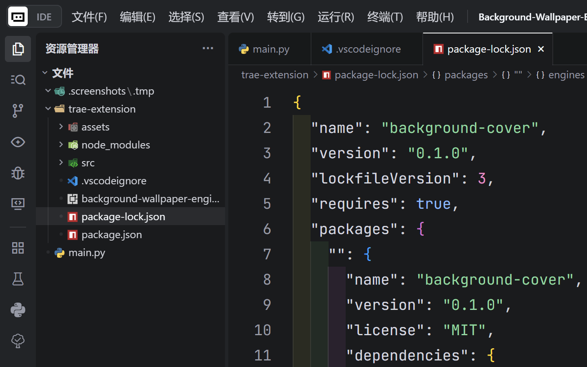

# 三市场上架文案（Background Wallpaper Engine）

渠道：**VS Code Marketplace** · **Open VSX** · **GitHub Releases**
扩展版本：**0.4.14** · publisher / namespace：`tisakonicc`

> 第 1 节是三个渠道共用的参数，先复制第 2 节到 VS Code，再把同一份（含第 3 节的安装命令）贴到 Open VSX，最后用第 4 节发 Release。

---

## 一、三渠道共用参数

| 字段 | 值 |
| --- | --- |
| displayName | `Background-Wallpaper-Engine` |
| version | `0.4.14` |
| publisher | `tisakonicc` |
| categories | `Visualization`, `Other` |
| engines | `^1.82.0` |
| license | `MIT` |
| icon | `assets/icon.png`（128×128） |
| galleryBanner | `#1f2430` / dark |

### 短描述（description，≤ 256 字符）

**英文（市场主用）**

```
Give your IDE a pulse: Steam Wallpaper Engine videos, scenes and web wallpapers play as your background with their own soundtrack, one-click readability tools and shareable .pkg packs. 100% local, no telemetry.
```

**中文（备用）**

```
让编辑器活起来：Steam Wallpaper Engine 的视频 / 场景 / 网页壁纸作为 IDE 背景播放，带壁纸原声、一键可读性增强，支持 .mpkg / .pkg 导入导出分享，全程本机运行、零联网零遥测。
```

### 关键词（keywords，市场按标签检索）

```json
[
  "wallpaper",
  "wallpaper engine",
  "background",
  "steam",
  "video background",
  "animated wallpaper",
  "scene.pkg",
  "mpkg",
  "ide background",
  "live wallpaper",
  "customization",
  "壁纸",
  "动态壁纸",
  "背景"
]
```

---

## 二、VS Code Marketplace

### 表单填写

- **Name**：`Background-Wallpaper-Engine`
- **Short description**：上文英文短描述
- **Categories**：`Visualization` + `Other`（不要选 `Themes`：本扩展不改配色主题）
- **Tags**：上文关键词
- **Repository**：`https://github.com/Tisakonicc/python-Wallpaper-Engine`
- **Issues**：`https://github.com/Tisakonicc/python-Wallpaper-Engine/issues`

### 详细描述（README 正文，直接替换 `trae-extension/README.md` 顶部）

```markdown
# Background-Wallpaper-Engine

**Give your IDE a pulse.** Steam Wallpaper Engine videos, scenes and web wallpapers play behind
your code — soundtrack included — while your code stays razor sharp. Local videos, images and
`scene.pkg` files drop in just as easily, and any wallpaper you love can be packed up and shared.

No account. No network. No telemetry. Everything stays on your machine.



| Dark wallpaper: defaults are fine | Bright wallpaper: turn on auto contrast |
| --- | --- |
|  |  |
| Calm, low-contrast artwork — code stays readable without extra dimming. | Lots of highlights — auto contrast dims by the 90th-percentile luminance and adds a touch of blur. |

**Live in 30 seconds:** install → fully quit and reopen your IDE → click **Wallpaper** in the
status bar → pick one.

### Why you'll keep it on

- **Wallpapers that actually move** — video, scene and web all play. Scenes are rendered by a
  WebGL runtime (webwallgl), with real animations, particles and shaders.
- **The soundtrack comes with it** — the wallpaper's own audio plays, with a live volume slider
  and one-click mute.
- **Pass it on** — import someone else's `.mpkg` / `.pkg`, or export your own as a self-contained
  `scene.pkg`. The receiver imports it directly — no Steam required.
- **Your code still wins** — auto contrast and text enhancement are one click away, and **off by
  default**, so the wallpaper looks exactly as authored.
- **Big libraries stay smooth** — covers are shrunk to 320 px on the local server and lazy-loaded;
  hundreds of wallpapers still scroll smoothly.

## Features

### Wallpapers and switching
- Click **Wallpaper** in the status bar to open the panel: current wallpaper, pause / refresh / clear,
  thumbnail grid, type filter and keyword search — one click to switch.
- Covers are cached as 320 px stills; only cards near the viewport load, GIF previews play on hover.

### Import and share
- **Local files**: any video, animated image or picture becomes a wallpaper. Files are **not copied**,
  only their paths are stored; `×` removes the entry without touching the source.
- **`.mpkg` (mobile)**: LZ4 and ETC2 textures are decoded and repacked; missing audio is backfilled
  from your desktop copy of the same wallpaper if you own it.
- **`.pkg` (desktop scene)**: works directly; a music property file is generated when `project.json`
  is missing.
- **Web wallpapers**: pick any folder containing `index.html`.
- **Export**: scene → self-contained `scene.pkg`; video / image → the original file; web → a full
  folder copy the receiver can import.

### Readability and playback
- Auto contrast (off by default): the local server downsamples the wallpaper to 32×18 grayscale and
  decides how much to dim / brighten, with a touch of blur for busy images.
- Text enhancement (off by default): strengthens editor, terminal, explorer and tab text without
  touching syntax colors.
- 1–144 FPS for scene / web wallpapers, one shared local service across windows.
- **Hardware decode first**: MediaCapabilities `powerEfficient` decides whether H.264 is GPU-decoded
  (WebCodecs is only a fallback for old kernels); when hardware decoding works the original video plays
  untouched, otherwise the 720p proxy takes over. The badge shows **checking / hardware / software /
  disconnected**, and **n/a** for wallpapers that are not videos.
- Volume 0–100% and mute; falls back to muted playback if the system blocks autoplay with audio.
- Music pauses only when the window is minimized — switching apps or clicking desktop icons keeps it playing.

### Install and restore
- Steam libraries are auto-detected (registry + `libraryfolders.vdf`), or set the root manually.
- **Remove injection** restores `workbench.html` byte-for-byte.

## Requirements

- Windows (Steam detection uses the registry)
- VS Code 1.82+ (desktop)
- Steam + Wallpaper Engine with subscribed wallpapers, or use local imports only
- **ffmpeg (recommended)**: for covers, video first frames and brightness analysis. Without it,
  wallpapers still play, but covers fall back and auto contrast does nothing.

## Notes

- The extension injects a background layer into `workbench.html` and, on VS Code, widens the main
  window's autoplay policy. This is an unofficial approach and may trigger an "installation appears
  corrupted" warning; the extension removes `workbench.html` from the `product.json` checksums so the
  warning disappears permanently after one full restart.
- Please fully quit and reopen the IDE after installing — reloading the window is not enough.
- Not affiliated with Trae, Steam or Wallpaper Engine. Wallpaper and music copyrights belong to their authors.

## Privacy

- The local HTTP service binds to `127.0.0.1` only (ports 32123–32128).
- No telemetry, no external requests, no modification or deletion of your wallpapers.
- Converted packages are cached under `D:\TraeData\Background-Wallpaper-Engine\mpkg`.
```

### Release Notes（贴到市场的 Change Log）

```markdown
## 0.4.14

| Before (0.4.13) | Now (0.4.14) |
| --- | --- |
| A wrong-port hit waited the full 4-second timeout | The server returns a tiny page that posts `wrongApp`; the injected script switches immediately |
| Ports owned by another IDE were retried every round | Confirmed wrong ports are skipped for 30 seconds |
| A correct port was abandoned if `/state` took over 4 seconds | After `boot`, wait up to 15 seconds instead of switching away |
| `/health` probe waited up to 1.5 s per port | 0.6 s |
| Late `boot` from an old navigation could trigger a wait | `boot` carries the navigation index and stale ones are dropped |

## 0.4.13

| Before (0.4.12) | Now (0.4.13) |
| --- | --- |
| A self-built H.264 sample was rejected as `Unsupported configuration`, so every machine showed "software" | Uses `mediaCapabilities.decodingInfo` `powerEfficient`; WebCodecs only for old kernels |
| A bare "—" when the probe result did not reach the panel | Explicit "disconnected"; auto re-report every 15 s |
| Scene / web wallpapers also showed decode states | Shows "n/a" — those wallpapers never go through video decoding |
| Other windows stayed on "—" forever | Non-owner windows read `/state.json` every 8 s |
| `diag.log` grew without limit (101 MB on one machine) | Rotates to `diag.log.1` after 8 MB |

## 0.4.12

Rolls up every fix from 0.4.1 to 0.4.12.

| Before (0.4.0) | Now (0.4.12) |
| --- | --- |
| Decode path guessed from the environment | WebCodecs probe decodes a real frame; panel badge shows checking / hardware / software; hardware decoding plays the original file |
| Music stuttered when the window was minimized | Mute + pause immediately on hide, block the web wallpaper's retry `play()`, 350 ms debounce on resume |
| Occasional "installation appears corrupted" warning | Two-step injection: drop the checksum first, write the injected block only after a full restart |
| Text enhancement had no effect in VS Code | Theme detection now uses `themeKind`; three-layer strengthening (surface, forced foreground, four shadows + hairline stroke) |
| Background sometimes needed a manual re-inject after reload | Fixed the escaped `app` field so the background reconnects on reload |

## 0.4.0

- Fixed: VS Code video wallpapers could remain silent because a duplicate `diagSent` declaration
  prevented the audio fallback from running. Audio transcoding now uses Vorbis instead of Opus for
  Chromium compatibility; stale Opus caches are invalidated automatically.
- Fixed: software-decoded 1080p / 4K videos could stutter in VS Code. VS Code now generates a 720p
  proxy in the background and switches to it automatically when ready.
- Added: 1080p / 720p / 480p / original video proxy quality options, with separate proxy caches for
  VS Code and Trae.
- Improved: per-step diagnostic throttling, codec capability checks, and video pause / waiting /
  seeking event logs.

## 0.3.3

- Fixed: web wallpaper track switching was being overwritten by the engine's default properties
  after iframe load. Now the chosen track is re-applied every 600 ms and also sent directly to the
  iframe's `wallpaperPropertyListener.applyUserProperties`.
- Fixed: custom dropdown options were unreadable in dark IDE themes (used for music track switching
  and wallpaper slideshow interval).
- Fixed: popping/click noise when the IDE window lost focus and audio paused. All three audio paths
  (video, scene engine and web iframe) now fade out before pausing (~80 ms) and fade back in when
  resuming (~120 ms).

## 0.3.2

- Fixed: switching the music track on web wallpapers had no effect — the engine overwrote the choice
  with `project.json` defaults when the iframe finished loading. The track is now persistently re-applied.
```

---

## 三、Open VSX

Open VSX 是 VSCodium / Theia / code-server / Gitpod 用户的主场。主体文案与 VS Code Marketplace 完全一致，只需把「安装方式」换成他们熟悉的命令行——用户扫一眼就知道该敲什么。

- **Namespace / Name**：`tisakonicc` / `background-wallpaper-engine`
- **Display name、短描述、分类、关键词、README 正文、Release Notes**：与 VS Code Marketplace **完全一致**，直接复用第 2 节
- 同一份 `.vsix` 直接上传，不需要单独构建

### README 末尾追加（Open VSX 专属）

````markdown
## Install from Open VSX

On VSCodium (or any editor that installs from Open VSX):

```bash
codium --install-extension tisakonicc.background-wallpaper-engine
```

Then **fully quit and reopen** your editor once — the background is injected at startup.

On plain VS Code? Install from the
[VS Code Marketplace](https://marketplace.visualstudio.com/items?itemName=tisakonicc.background-wallpaper-engine).
````

- 发布命令（本机已登录时）：

```bash
npx ovsx publish background-wallpaper-engine-0.4.14.vsix -p <token>
```

---

## 四、GitHub Releases

### Tag 与标题

- Tag：`trae-v0.4.14`（沿用现有约定：`trae-v*` 给 VSIX，`pycharm-v*` 给插件 zip）
- Release title：`Trae / VS Code 扩展 v0.4.14`
- 是否勾选 Latest：**是**（三渠道的主版本）

### Release 正文模板

正文直接使用根目录的 [`release-notes.md`](release-notes.md)（v0.4.14，含效果图、版本对比与安装步骤），不要再单独维护一份模板。

### 发布前命令

```powershell
# 1) 构建（已在 trae-extension 目录）
npm run package

# 2) 校验和（贴进 Release 正文）
Get-FileHash background-wallpaper-engine-0.4.14.vsix -Algorithm SHA256 | ForEach-Object Hash

# 3) 传 GitHub Release
gh release create trae-v0.4.14 background-wallpaper-engine-0.4.14.vsix `
  --title "Trae / VS Code 扩展 v0.4.14" --notes-file release-notes.md --latest
```

---

## 五、检错与修复记录

已直接改掉（`git diff` 可核对）：

| 问题 | 改动位置 |
| --- | --- |
| 版本号过期 | 根 `README.md`、`trae-extension/README.md`、`trae-extension/CHANGELOG.md`、`release-notes.md`、`marketplace-copy.md` 的表格、直链、下载名、安装命令、Release Notes 全部更新到 **0.4.14**；PyCharm 插件保持 **0.9.24**；SHA-256 已填入 `release-notes.md`（`ABB70EE7…491DD`） |
| README 没有效果图 / 版本对比 | 新增 `docs/images/`（Trae 截图、两张壁纸示例、工作原理图、解码徽章图），根 README 增加「一眼看懂」「工作原理」「能力对照」「这版更新了什么」四节 |
| 「VS Code 官方市场不收录本扩展」与「已上架 VS Code 官方市场」自相矛盾 | 根 `README.md` 改为「本扩展已上架 VS Code Marketplace 与 Open VSX」 |
| `package.json` 短描述为中文长句 | 换成第 1 节的英文短描述（≤ 256 字符） |
| `categories` 含 `Themes` | 改为 `Visualization` + `Other` |
| `activationEvents` 为 `["*"]` 会触发打包告警 | 改为 `onStartupFinished` |
| `untrustedWorkspaces.supported: true` 与改写 `workbench.html` 矛盾 | 改为 `false` |
| 两个 README 开头的多个 BOM | 已清除（首字节现在是 `#`） |
| 术语 `VS Market` | 改为 `VS Code Marketplace` |
| 根 README「与 0.2.11 相比」的过期说明 | 改为当前能力概述 |

补充完成：

- 新增 `trae-extension/CHANGELOG.md`（0.2.15–0.2.29），README 的更新日志改为摘要 + 链接；VS Code / Open VSX 会自动展示 Changelog 页签。
- 合并 ffmpeg 重复说明：环境要求里只留一句，细节统一收在 FAQ。
- PyCharm 插件按要求未改动。
