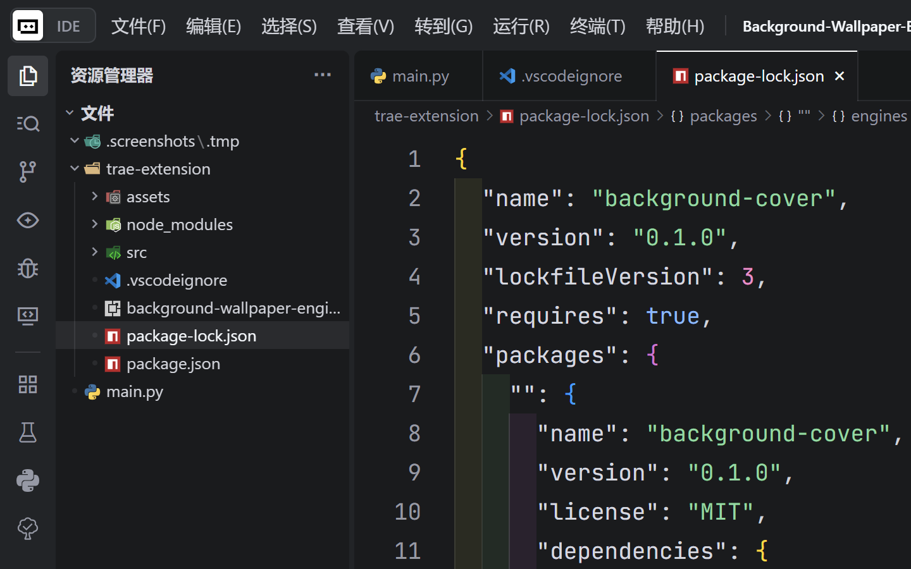
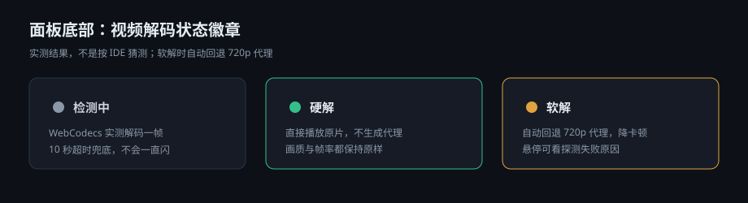

把 Wallpaper Engine 的壁纸搬进 IDE：视频 / 场景 / 网页壁纸都能动，带壁纸原声，支持 `.mpkg` / `.pkg`
导入导出分享。全程本机运行，不联网、不上传数据。

v0.4.12 汇总了 0.4.1–0.4.12 的连续修复，重点解决三件事：**视频到底有没有硬解**、
**窗口最小化后音乐断断续续**、以及反复出现的 **「安装似乎损坏」**。



## 一眼对比

| 0.4.0 | 0.4.12 |
| --- | --- |
| 视频编码方式只能靠环境猜，软解 / 硬解不可见 | WebCodecs 实测解码一帧，面板底部显示「检测中 / 硬解 / 软解」；硬解可用直接播原片 |
| 最小化、跑后台任务时音乐断断续续 | 隐藏时立即静音并暂停、拦截脚本重试的 `play()`，恢复播放加 350ms 防抖 |
| 首次注入可能弹「安装似乎损坏」 | 注入拆成两步：先摘除校验项，完全重启后再写入注入块，提示不再出现 |
| VS Code 下文字增强不生效 | 改用主题类型判断，并升级为三层强化（底衬 + 强制前景 + 四层阴影与描边） |
| 重载窗口后偶尔需要手动重新注入背景 | 修正注入块 `app` 字段路径转义，重载后自动恢复 |

三种解码状态：



## 新增

- **硬解实测与自动选择**：渲染页用 WebCodecs v2 探针（1280×720 Constrained Baseline + AVCC description）
  实际解码一帧，成功才判定硬解可用。硬解可用直接播放原片，不再多生成代理；不可用时自动回退 720p 代理。
- **解码状态徽章**：面板底部左侧显示「检测中（灰）/ 硬解（绿）/ 软解（琥珀）」，软解时悬停可看探测
  失败原因；连接失败有 10 秒超时兜底，不会一直闪烁。

## 修复

- **最小化后音乐断续**：隐藏窗口时立即静音并 `pause`，不再依赖 0.6 秒轮询里的延迟暂停；拦截网页壁纸
  脚本每 3 秒重试的 `play()`；隐藏期间音量与曲目属性不重复下发；恢复播放加 350ms 防抖。
  窗口仍可见时切换应用、点击或拖动桌面图标，音乐保持播放。
- **「安装似乎损坏」**：注入拆成两步，第一次启动只从 `product.json` 的 `checksums` 移除
  `workbench.html` 并提示完全重启，完全重启后才写入注入块；升级只在缺少注入块时重写。
- **文字增强**：修复 VS Code 下不生效（改用 `themeKind` 判断主题）；升级为 42% 主题色底衬 +
  强制前景色 + 四层阴影与细描边的三层方案，只改前景色与阴影，不动语法高亮。
- **背景自动显示**：修正注入块 `app` 字段路径转义错误；移除自动添加的面板底衬；重启提示去掉负面表述。

## 安装

**方式一：VSIX（Trae CN / VS Code / VSCodium 通用）**

1. 下载下方 `background-wallpaper-engine-0.4.12.vsix`；
2. 扩展面板右上角 `···` → **从 VSIX 安装**（也可直接把 vsix 拖进扩展面板）；
3. **完全退出 IDE 再打开**一次，让扩展完成首次注入。

**方式二：市场安装**

- VS Code：[VS Code Marketplace](https://marketplace.visualstudio.com/items?itemName=tisakonicc.background-wallpaper-engine)
- Open VSX（VSCodium / Theia / code-server / Gitpod）：

```bash
codium --install-extension tisakonicc.background-wallpaper-engine
```

## 附件

| 文件 | 用途 |
| --- | --- |
| `background-wallpaper-engine-0.4.12.vsix` | VS Code / Trae CN / VSCodium 通用 |

SHA-256：

```
403B899BAB976C284B520F806EAC62D104E9AD44B40D3945A4D557740CFF380E
```

## 说明

- 扩展通过注入 `workbench.html` 实现背景与音频，属非官方实现；采用两步注入后不再出现完整性提示，
  面板底部「移除注入」可逐字节还原。
- 与 Trae、Steam、Wallpaper Engine 均无隶属关系；壁纸及音乐版权归原作者所有。
- PyCharm 插件请到 [`pycharm-v0.9.24`](https://github.com/Tisakonicc/python-Wallpaper-Engine/releases/tag/pycharm-v0.9.24) 下载。
