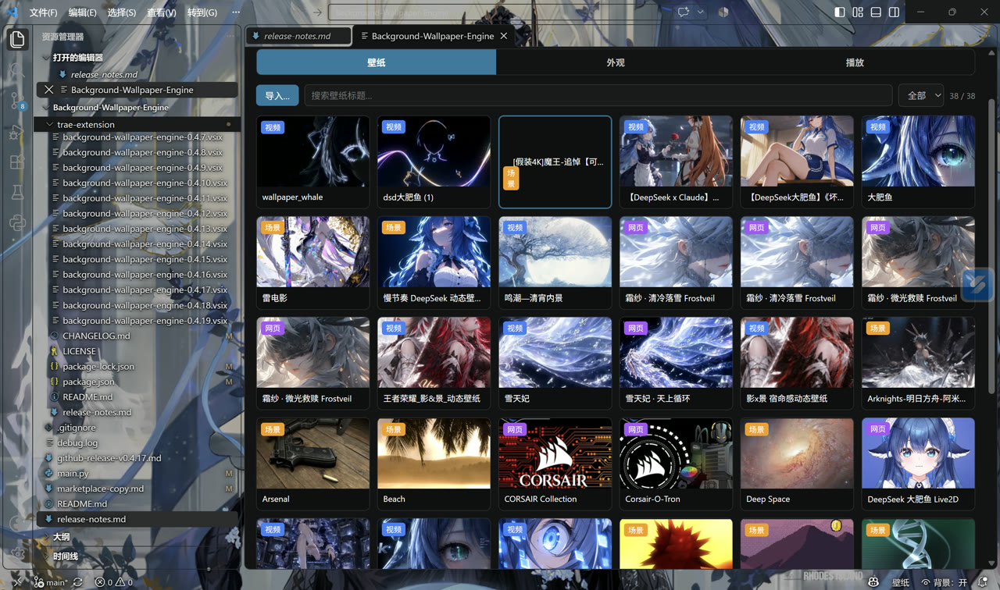
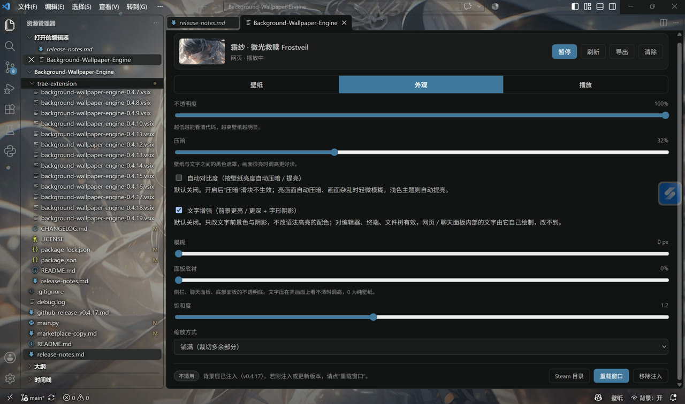
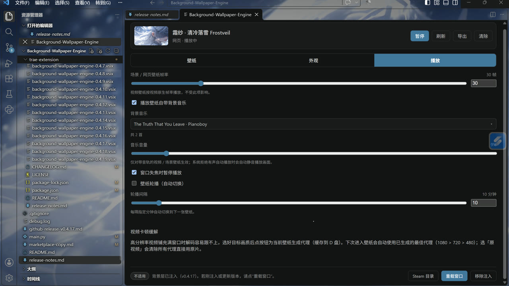
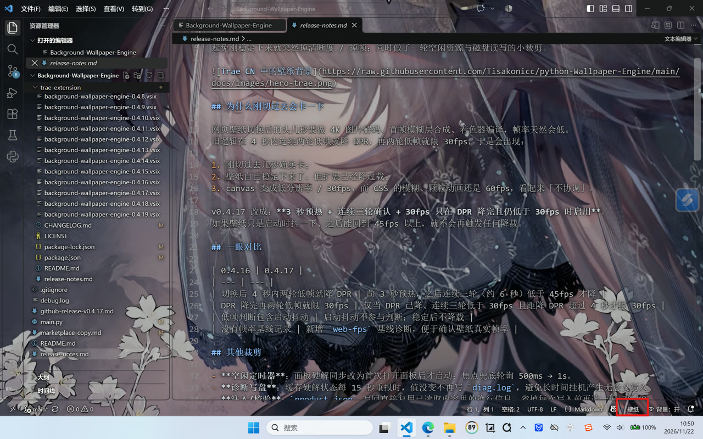

把 Wallpaper Engine 的壁纸搬进 IDE：视频 / 场景 / 网页壁纸都能动，带壁纸原声，支持 `.mpkg` / `.pkg`
导入导出分享。全程本机运行，不联网、不上传数据。

v0.4.17 调整 **网页壁纸的降载时机**：切换过去后的头几秒不再被误判成「持续卡顿」，
避免刚稳定下来就突然掉清晰度 / 掉帧；同时做了一轮空闲资源与磁盘读写的小裁剪。


## 为什么刚切过去会卡一下

网页壁纸切换后的头几秒要做 4K 图片解码、首帧模糊层合成、着色器编译，帧率天然会低。
旧逻辑在 4 秒内连续两轮低帧就降 DPR，再两轮低帧就限 30fps，于是会出现：

1. 刚切过去几秒确实卡；
2. 壁纸自己稳定下来了，但扩展已经降过载；
3. canvas 变成低分辨率 / 30fps，而 CSS 的模糊、颗粒动画还是 60fps，看起来「不协调」。

v0.4.17 改成：**3 秒预热 + 连续两轮确认 + 30fps 只在 DPR 降完且仍低于 34fps 时启用**。
如果壁纸只是启动时抖一下、之后能回到 45fps 以上，就不会再触发任何降载。

## 一眼对比

| 0.4.16 | 0.4.17 |
| --- | --- |
| 切换后 4 秒内两轮低帧就降 DPR | 前 3 秒预热，之后连续两轮（约 4 秒）低于 45fps 才降 |
| DPR 降完再两轮低帧就限 30fps | 仅当 DPR 已降、连续两轮低于 34fps 且距降 DPR 超过 3 秒才限 30fps |
| 低帧判断包含启动抖动 | 启动抖动不参与判断；稳定后不降载 |
| 没有帧率基线记录 | 新增 `web-fps` / `scene-fps` 诊断，便于确认壁纸真实帧率 |

## 其他裁剪

- **空闲定时器**：面板硬解同步改为首次打开面板后才启动；焦点兜底轮询 500ms → 1s。
- **诊断写盘**：缓存硬解状态每 15 秒重报时，值没变不再写 `diag.log`，避免长时间挂机产生无意义写入。
- **注入/校验**：`product.json` 写回直接复用已读取内容里的换行信息，省掉每次写入前再读一遍 78 KB。
- **适配层**：新增 `src/ide.js`，集中 `flavorOf()` / `proxyNamespace()`，取代散落的 `IS_TRAE`
  与 VS Code 正则判断；行为不变，后续 Trae 升级更容易维护。
- **场景壁纸音频**：指针活动转发给引擎，修复可交互场景壁纸待机计时到点后自己播待机语音
  （听起来像音乐重头播放、还叠着另一份声音）；销毁旧实例前先静音，避免切换瞬间两段声音叠加。
- **帧率切换**：调帧率不再重建场景/网页壁纸，改调引擎 `setFps()`，不会再把音乐打回开头。
- **注入修订号 rev 7**：`runtime.js` 有变化，升级后需要重载一次窗口完成重注入。

## 面板与设置

| 壁纸库 | 外观 |
| --- | --- |
|  |  |

| 播放 | 版本说明 |
| --- | --- |
|  |  |

## 安装

**方式一：VSIX（Trae CN / VS Code / VSCodium 通用）**

1. 下载下方 `background-wallpaper-engine-0.4.17.vsix`；
2. 扩展面板右上角 `···` → **从 VSIX 安装**（也可直接把 vsix 拖进扩展面板）；
3. **完全退出 IDE 再打开**一次，让扩展完成首次注入；已装旧版的用户升级后重载一次窗口。

**方式二：市场安装**

- VS Code：[VS Code Marketplace](https://marketplace.visualstudio.com/items?itemName=tisakonicc.background-wallpaper-engine)
- Open VSX（VSCodium / Theia / code-server / Gitpod）：

```bash
codium --install-extension tisakonicc.background-wallpaper-engine
```

## 附件

| 文件 | 用途 |
| --- | --- |
| `background-wallpaper-engine-0.4.17.vsix` | VS Code / Trae CN / VSCodium 通用 |

SHA-256：

```
0E32BB4A232948C76631D9F9730CE76F489DA663D55B0CCBBCEAE7A76238E111
```

## 说明

- 本次包含网页壁纸降载时机的修正、扩展侧开销裁剪，以及场景壁纸音频/帧率切换的修复。
- 如果降载仍然发生且观感突兀，可以在面板里把网页壁纸 FPS 固定到 60，或把壁纸自身的 Density / Grain 调低。
- PyCharm 插件本次无变化，仍是 [`pycharm-v0.9.24`](https://github.com/Tisakonicc/python-Wallpaper-Engine/releases/tag/pycharm-v0.9.24)。
