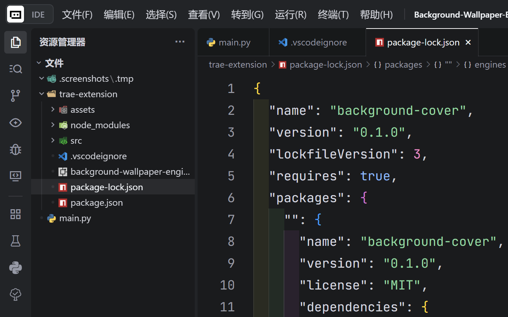
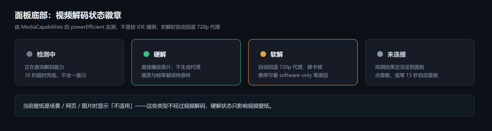

# Background-Wallpaper-Engine

**让编辑器活起来。** 把 Steam Wallpaper Engine 的视频、场景、网页壁纸铺到代码背后，连壁纸自带的音乐一起播放——代码依旧清晰锐利。本地视频、图片和 `scene.pkg` 也能直接导入，做好的壁纸还能打包分享给朋友。

全程本机运行：不联网、不上传、不收集数据，连账号都不用注册。

> **30 秒上手**：安装 → 完全退出 IDE 再打开 → 点状态栏「壁纸」挑一张。



| 暗色壁纸：默认设置就够清晰 | 亮色壁纸：建议开「自动对比度」或调高「面板底衬」 |
| --- | --- |
|  |  |
| 画面偏暗、明暗平缓，代码对比足够，保持默认即可。 | 高光多、画面亮，压暗后文字才稳；自动对比度按亮部自动补压暗与轻微模糊。 |

解码状态徽章的三种样子：



- 作者：Tisako
- 版本：0.4.15
- 许可证：MIT
- 支持：Trae CN / VS Code（桌面版）
- 发布：[GitHub Releases](https://github.com/Tisakonicc/python-Wallpaper-Engine/releases) · [VS Code Marketplace](https://marketplace.visualstudio.com/items?itemName=tisakonicc.background-wallpaper-engine) · [Open VSX](https://open-vsx.org/extension/tisakonicc/background-wallpaper-engine)

---

## 亮点

- **会动的壁纸，不是一张贴图**：视频、场景、网页壁纸都能跑；场景壁纸的动画、粒子、shader 由 WebGL 运行时真实渲染，和 Steam 里看到的一样。
- **声音也一起搬进来**：壁纸自带的音轨与场景音乐直接播放，音量实时可调，一键静音；窗口最小化才暂停，切应用不中断。
- **能硬解就不软解**：用 MediaCapabilities 的 `powerEfficient` 判断能否硬件解码（旧内核退回 WebCodecs 实测），硬解可用直接播原片，否则回退 720p 代理；面板底部有「检测中 / 硬解 / 软解 / 未连接」徽章，非视频壁纸显示「不适用」。
- **好看的壁纸，值得分享**：导入别人的 `.mpkg` / `.pkg`，或把自己的壁纸导出成自包含 `scene.pkg`——对方不需要 Steam 也能直接用。
- **代码永远看得清**：一键自动对比度 + 文字增强，亮画面上的代码不再糊成一片；两项默认关闭，壁纸保持原作者的样子。
- **几百张壁纸也不卡**：封面在本地服务缩成 320px 并懒加载，翻列表依旧顺滑。

## 功能特性

### 壁纸与切换

- 状态栏右侧「壁纸」按钮打开面板，顶部显示当前壁纸（缩略图、标题、类型、状态），支持暂停 / 刷新 / 清除。
- 缩略图网格按「视频 / 场景 / 网页 / 图片」筛选，支持关键词搜索，点一下即切换。
- 封面由本地服务用 ffmpeg 缩成 320px 静态小图并缓存，列表只加载视口附近的卡片，鼠标悬停时才换回原始封面播放 GIF 动画。

### 导入与分享

- **本地文件**：任意视频、动图、图片当作壁纸，**不复制文件**，只记录路径；导入项右上角 `×` 可移除（不会删除源文件）。
- **Wallpaper Engine 资源包**：
  - `.mpkg`（手机包）：自动解 LZ4 + ETC2 纹理并重新打包；包里被剥掉的音乐，若本机订阅过同一张壁纸，会从桌面版自动补齐。
  - `.pkg`（桌面场景包）：直接可用；缺少 `project.json` 时自动补一份音乐属性，默认播第一首。
- **网页壁纸**：选一个含 `index.html` 的文件夹即可。
- **导出**：顶部「导出」对任意壁纸可用。场景导出 `scene.pkg`（画面 + 音乐自包含），视频 / 图片导出原文件，网页壁纸整份目录复制；也支持命令「导出场景包为 scene.pkg（分享用）」。
- 转换缓存位于 `D:\TraeData\Background-Wallpaper-Engine\mpkg`。

### 可读性

- **自动对比度**（默认关闭）：本地服务把当前壁纸缩成 32×18 灰度，计算平均亮度、90 分位亮度与方差。深色主题按亮部压暗到安全区间（水花、灯光这类高光也能压住），浅色主题用白色遮罩提亮，画面越花越补一点模糊。开启后「压暗」滑块不再生效；壁纸本身较暗、文字已经清楚时不必开。
- **文字增强**（默认关闭）：把前景文字推向纯白（深色主题）/ 纯黑（浅色主题），并给编辑器、终端、文件树、标签页加同色系阴影。只覆盖前景变量，不动语法高亮的 token 配色；对编辑器、终端、文件树有效，网页 / 聊天面板内部的文字由它自己绘制，改不到。
- **什么时候打开**：壁纸偏亮、偏花，代码或文件名压在画面上发虚时，到面板「外观」里勾选这两项；日常纯色或暗色壁纸保持关闭即可，画面与配色都是原样。
- **面板底衬**（默认 0）：需要时给侧栏、聊天面板、底部面板铺一层主题色半透明底，0 为纯壁纸，1 为完全遮住，滑块可调。聊天面板是独立 webview，父页面样式进不去，只能靠它垫底。

### 播放与性能

- 场景 / 网页壁纸帧率 1–144 可调，可直接输入数字。
- 仅在窗口最小化时暂停，切应用、点击桌面图标不中断；多窗口共用一个本地服务，服务消失后自动接管。
- 播放视频音轨与场景 / 网页音效，支持静音与 0–100% 音量；系统拒绝有声自动播放时自动退回静音，画面不受影响。
- **解码状态**：面板底部显示「检测中 / 硬解 / 软解 / 未连接」。硬解可用时视频直接播原片、不生成代理；软解时自动回退 720p 代理，悬停徽章可看探测失败原因。当前壁纸不是视频时显示「不适用」；「未连接」表示探测结果还没送到面板，点一次重载或等渲染页 15 秒后自动重报。

### 稳定性与可还原

- 自动探测 Steam 库（注册表 + `libraryfolders.vdf`），多磁盘也能找到，也可手动指定目录。
- 注入拆成两步：先摘除校验项，完全重启后再写入注入块，**不再出现「安装似乎损坏」**；升级只在缺少注入块时重写。
- 面板底部「移除注入」会把 `workbench.html` 逐字节还原到注入前状态。

## 环境要求

- Windows（Steam 探测依赖注册表）
- Trae CN 或 VS Code 1.82 及以上（桌面版）
- 已安装 Steam 与 Wallpaper Engine 并订阅了壁纸，或直接使用本地导入
- **ffmpeg（强烈建议）**：封面缩略图、视频抽帧与亮度分析都依赖它，缺失时的表现见下文 FAQ

## 安装

> Trae CN 使用自建市场、VS Code 使用官方市场。本扩展已上架 **VS Code 官方市场** 与 **Open VSX**；Trae CN 自建市场暂未收录，Trae 用户请用方式一 / 方式二安装 vsix。

### 方式一：VSIX 安装（推荐，Trae CN 与 VS Code 通用）

1. 到 [Releases](https://github.com/Tisakonicc/python-Wallpaper-Engine/releases/latest) 下载 `background-wallpaper-engine-0.4.15.vsix`；
2. 打开 IDE 扩展面板，点右上角 `···` → **从 VSIX 安装**，选中刚下载的文件（也可直接把 vsix 拖进扩展面板）；
3. **完全退出 IDE 再重新打开**（不是重载窗口），让扩展完成首次注入。

### 方式二：命令行安装

```powershell
# Trae CN
& "D:\trae\Trae CN\bin\trae-cn.cmd" --install-extension background-wallpaper-engine-0.4.15.vsix --force

# VS Code
code --install-extension background-wallpaper-engine-0.4.15.vsix --force
```

### 方式三：市场安装（VS Code 用户最省事）

**VS Code 官方市场**

- 商店页：[Background-Wallpaper-Engine](https://marketplace.visualstudio.com/items?itemName=tisakonicc.background-wallpaper-engine)（点页面上的 **Install** 会调起 VS Code 安装）
- 图形界面：左侧扩展面板（`Ctrl+Shift+X`）→ 搜索 `Background-Wallpaper-Engine` → 认准发布者 `tisakonicc` → 安装
- 命令行：

```powershell
code --install-extension tisakonicc.background-wallpaper-engine
```

**Open VSX**（VSCodium / Theia / code-server / Gitpod）

- 商店页：[open-vsx.org/extension/tisakonicc/background-wallpaper-engine](https://open-vsx.org/extension/tisakonicc/background-wallpaper-engine)
- 命令行：

```powershell
codium --install-extension tisakonicc.background-wallpaper-engine
```

> 市场安装与 VSIX 安装效果完全相同，都必须在装完后**完全退出 IDE 再打开**一次，注入才会生效。
> 市场页面更新可能滞后，版本不一致时以 Releases 里的 vsix 为准。

## 使用

1. 点击状态栏右下角 `壁纸`（或 `Ctrl+Shift+P` 执行「打开壁纸面板」）。
2. 在「壁纸」标签页挑一张，背景立即切换。
3. 「外观」「播放」标签页可实时微调观感：自动对比度与文字增强**默认关闭**，需要时在「外观」里勾选；音量、帧率在「播放」里调。
4. 想用本地文件：点「导入…」，选择视频、图片、`.mpkg`、`.pkg` 或含 `index.html` 的文件夹，导入后直接应用。
5. 想分享：点「导出」（或卡片左上角 `⇩`），把产物发给对方导入即可。

状态栏 `背景：开 / 关` 可快速暂停或恢复显示，不会撤销注入。

> VS Code 用户注意：VS Code 默认禁止无手势的有声自动播放，扩展会自动放宽其主窗口的 `autoplayPolicy`。改动在主进程启动时读取，因此需要**完全退出 VS Code 再打开一次**（仅重载窗口不出声）。

## 支持的类型

| 类型 | 说明 |
| --- | --- |
| video | `.mp4` `.webm` `.mov` `.m4v`（`.mkv` 为 Matroska，Chromium 不支持，会黑屏，未纳入） |
| image | `.gif` `.apng` `.webp` 及导入的 `.png` `.jpg` `.jpeg` `.bmp` `.avif` |
| web | 含 `index.html` 的壁纸目录 |
| scene | 由 `webwallgl` 运行时渲染；导入的 `.mpkg` / `.pkg` 转换后按此类型播放 |

> 场景壁纸由第三方运行时解释执行，极复杂的 shader 可能存在兼容性问题；遇到无法渲染的场景壁纸，可换用视频版本。

## 配置项

| 配置 | 默认 | 说明 |
| --- | --- | --- |
| `backgroundWallpaperEngine.enabled` | `true` | 是否显示背景 |
| `backgroundWallpaperEngine.wallpaperId` | 空 | 当前壁纸 ID（面板写入，无需手改） |
| `backgroundWallpaperEngine.steamRoot` | 空 | Steam 安装目录，留空自动探测 |
| `backgroundWallpaperEngine.opacity` | `0.45` | 壁纸不透明度 |
| `backgroundWallpaperEngine.scrim` | `0.45` | 压暗层强度（开启自动对比度时不生效） |
| `backgroundWallpaperEngine.autoContrast` | `false` | 按壁纸亮部自动压暗 / 提亮并补模糊 |
| `backgroundWallpaperEngine.textContrast` | `false` | 文字增强：前景推向纯白 / 纯黑并加字形阴影 |
| `backgroundWallpaperEngine.surfaceOpacity` | `0` | 侧栏 / 聊天 / 底部面板底衬强度（0–1） |
| `backgroundWallpaperEngine.blur` | `0` | 模糊半径（0–40 px） |
| `backgroundWallpaperEngine.saturate` | `1` | 饱和度（0 为灰度，最大 3） |
| `backgroundWallpaperEngine.fit` | `cover` | `cover` / `contain` / `fill` |
| `backgroundWallpaperEngine.fps` | `60` | 场景 / 网页壁纸帧率（1–144） |
| `backgroundWallpaperEngine.muted` | `false` | 静音壁纸自带背景音乐 |
| `backgroundWallpaperEngine.volume` | `0.6` | 背景音乐音量（0–1） |
| `backgroundWallpaperEngine.pauseOnBlur` | `true` | 失焦暂停播放 |

## 常见问题

**导入的 `.mpkg` 只有画面没有音乐？**
手机包在导出时就把音轨剥掉了，文件里没有可解码的音频数据。若本机订阅过同一张壁纸，扩展会从桌面版 `scene.pkg` 自动补齐；补不到就只剩画面。想要带音乐的版本，请导出 `scene.pkg` 分享。

**场景壁纸黑屏 / 只显示静态预览？**
说明该场景用到了运行时尚未支持的 shader。可尝试换视频版本，或把 `fps` 调低后重试。

**视频壁纸没有封面图？**
需要 ffmpeg 抽帧。确认 `ffmpeg` 在 PATH 中，或把可执行文件路径写入环境变量 `FFMPEG_PATH`。未安装时壁纸仍可播放，但列表封面退化为原图，自动对比度也不生效。

**聊天面板里的字还是看不清？**
聊天面板是独立 webview，父页面样式进不去。把「面板底衬」调到 0.4–0.6，在它背后垫一层即可。

**面板底部显示「软解」怎么办？**
说明当前 IDE 的 Chromium 没有把 H.264 交给 GPU 解码。扩展会自动回退到 720p 代理，先保证流畅；悬停徽章可以看到原因（`software-only` / `media-cap-unsupported`）。更新显卡驱动、或在 IDE 启动参数里确认没有禁用硬件加速，通常会回到「硬解」。软解状态下播 1080p / 4K 原片容易卡顿，不代表壁纸有问题。

**网页壁纸（如「魔王追悼」）很卡？**
这类壁纸常见 4K 底图 + 多层 `blur` / `mix-blend-mode` + 粒子 canvas，核显和高缩放屏幕下会吃满 GPU。0.4.15 起会统计 iframe 真实帧率：连续低于 45fps 先把 DPR 降到 1（canvas 像素 1/4），仍低于 38fps 再限到约 30fps。也可以进一步把壁纸自身的 Density 调低、Grain 关掉、Audio Reactive 关掉。

**显示「未连接」或「不适用」？**
「不适用」只会在当前壁纸是场景 / 网页 / 图片时出现——这些类型不经过视频解码，硬解状态没有意义。「未连接」表示探测结果还没送到面板：点一次「重载窗口」，或等渲染页 15 秒后自动重报；多窗口时非服务属主窗口也会从本地服务补齐状态。

**提示「安装似乎损坏」？**
0.4.5 起不应再出现：首次注入会先要求完全重启一次 IDE，重启后才写入背景层。见下方专节。

## 关于「安装似乎损坏」

IDE 会在启动后校验 `workbench.html` 的哈希，而校验清单是**启动时读进内存**的：如果本次会话里改了这个文件，就必然对不上，于是弹一次「安装似乎损坏」。本扩展把注入拆成两步，从根上避免这条提示：

1. **第一次启动**：只从 `product.json` 的 `checksums` 里移除 `workbench.html` 这一项，不改动文件本身，并提示完全重启；
2. **完全重启之后**：校验清单里已经不含该文件，此时再写入注入块并提示重载窗口，完整性检查不会再报任何东西。

- 只影响这一个文件，其余校验项不变；
- 在提示完全重启之前，即使手动重载窗口也不会提前写入，因此这条提示不会出现；
- 点「移除背景并还原 IDE」时会把校验项按还原后的真实内容补回；
- IDE 升级覆盖安装目录后，扩展会在下次启动时自动重新注入并再次脱钩。

## 隐私与安全

- 本地 HTTP 服务只监听 `127.0.0.1`（端口 32123–32128），不对公网开放；
- 不收集、不上传任何数据，不访问外网；
- 只读取 Steam 壁纸目录与导入的文件，不修改、不删除；视频 / 图片不复制，`.mpkg` / `.pkg` 只在 `D:\TraeData\Background-Wallpaper-Engine\mpkg` 生成转换缓存，封面缩略图缓存在同目录的 `thumbs`；
- 同源限制 + 目录越权检查（403）保证导入项只能读取自己的文件（手机包转换后为 `scene.pkg` 与 `project.json`）。

## 卸载与还原

> **先还原，再卸载**：直接卸载扩展不会自动还原 `workbench.html`，请按顺序操作。

1. 打开面板 → 底部「移除注入」，把 `workbench.html` 还原；
2. 完全退出 IDE；
3. 在扩展页卸载本扩展。

还原备份位于安装目录 `resources/app/out/vs/code/electron-browser/workbench/` 下，形如 `workbench.html.backgroundcover-<哈希>.bak`。

若忘记先点「移除注入」就直接卸载，也不会留下改过的文件：IDE 卸载时会往 `extensions\.obsolete` 写入待删除标记，扩展在退出时检测到就自动还原 `workbench.html`、补回校验项并删除 `.bak`。只有卸载后直接强杀进程（`deactivate` 未执行）才会留下文件；这种情况下注入脚本会在连续 40 次（约 70 秒）连不到本地服务后清掉自己创建的 iframe 与样式，不再空转。

## 更新日志

完整版本历史见 [CHANGELOG.md](CHANGELOG.md)。最新几版：

- **0.4.15**：网页壁纸自适应降载——连续掉帧时 iframe DPR 自动降到 1（canvas 像素 1/4），仍低再限到约 30fps；只在壁纸可见时判断，4K + 全屏模糊类壁纸不再把 IDE 拖卡。
- **0.4.14**：Trae 启动链路优化——错误端口立即切换、跳过已确认的他人端口、boot 后等 state 15 秒不误换、`/health` 探活 1.5s → 0.6s；注入修订号升到 rev 5，升级后需重载一次。
- **0.4.13**：硬解改用 MediaCapabilities 的 `powerEfficient` 判断，修正此前一律误判「软解」；徽章补上「未连接」「不适用」；多窗口 / 扩展宿主重启后自动恢复状态；`diag.log` 超过 8 MB 自动轮转，超过 32 MB 直接清空。
- **0.4.12**：新增实测硬解探测与「检测中 / 硬解 / 软解」徽章，硬解可用直接播原片；修复最小化后音乐断续；两步注入彻底消除「安装似乎损坏」；文字增强在 VS Code 生效并三层强化；修正注入块 `app` 字段，重载后背景自动恢复。
- **0.4.0**：修复 VS Code 视频壁纸无声与卡顿；音频转码改用 Vorbis，VS Code 默认生成 720p 代理；新增代理画质下拉框、按 IDE 隔离缓存和更详细的诊断日志。
- **0.3.3**：修复自定义自绘下拉组件在暗色主题下选项文字看不清；网页壁纸切换背景音乐时除了引擎 `setProperties`，还会每 600ms 持续重投一次并直接调用 iframe 内 `wallpaperPropertyListener.applyUserProperties`，防止引擎默认值覆盖用户选择。
- **0.3.2**：修复网页壁纸切换背景音乐不生效（引擎加载完成后用 `project.json` 默认属性覆盖一次，现在持续重新投递并调用页面自己的 listener）。
- **0.3.1**：「播放」页新增背景音乐下拉框（场景 / 网页壁纸自带多首音乐时可切换）与壁纸轮播。
- **0.2.29**：修复网页壁纸导出目录名被按 GBK 重编码成乱码的问题（改用 `robocopy` 复制，中文路径落盘正确）；导出名优先取 `project.json` 的 `title`。

## 免责声明

本扩展通过修改 IDE 的 `workbench.html`（VS Code 下还会修改主进程自动播放策略）实现背景与音频效果，属于非官方实现；注入采用两步流程后不再触发完整性提示，使用前仍请自行评估风险。本扩展与 Trae、Steam、Wallpaper Engine 均无隶属或合作关系；壁纸及音乐版权归原作者所有。

## 致谢

- 场景壁纸渲染依赖 [webwallgl](https://www.npmjs.com/package/webwallgl)
- 思路参考 [dsh-wallpaper-engine](https://github.com/Fish-under-sea/dsh-wallpaper-engine)
